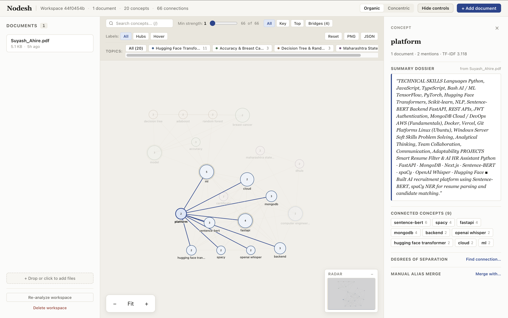

<div align="center">

# Nodesh

### Ideas connected. Knowledge discovered.

Turn documents into an interactive knowledge graph. Explore the concepts, follow their connections, and trace them back to the source text.

**[Open Nodesh →](https://nodesh.vercel.app)** · [API docs](https://nodesh-api.onrender.com/docs) · [Deployment guide](docs/DEPLOYMENT.md)

No signup · No AI API keys · Statistical NLP

</div>

[](https://nodesh.vercel.app)

## From files to connections

Research papers, study notes, and project documents often describe related ideas in different places. Nodesh brings those ideas into one map you can explore.

Upload a document, let the workspace analyze it, then select a concept to see its source sentences and neighbors. Add more files to discover shared concepts and compare what each document contributes.

Nodesh uses classical NLP and graph algorithms. It does not call an LLM, generate answers from a prompt, or require a model download.

## Explore the workspace

| Feature | What you can do |
| --- | --- |
| **Multiple documents** | Add PDF, DOCX, TXT, and Markdown files to the same anonymous workspace. |
| **Interactive graph** | Switch between organic and concentric layouts; pan, zoom, and drag concepts. |
| **Concept inspector** | Read extractive summaries, occurrence counts, source filenames, and connected concepts. |
| **Relationship evidence** | Select a connection to inspect supporting text and association metrics. |
| **Topics and bridges** | Explore automatically grouped concepts and highlight ideas that connect different parts of the graph. |
| **Connection paths** | Find the shortest path between two concepts and inspect the evidence along the way. |
| **Document comparison** | Compare shared and unique concepts, with pairwise Jaccard overlap. |
| **Manual merging** | Review likely aliases and merge duplicate concepts without modifying source files. |
| **Search and filters** | Find concepts, focus on a document, adjust connection strength, and control label density. |
| **Exports** | Download the graph as JSON or export an image as PNG. |
| **Mobile layout** | Open documents on demand, use touch zoom controls, and inspect concepts in a bottom sheet. |

## Try it

1. Open **[nodesh.vercel.app](https://nodesh.vercel.app)**. A workspace is created automatically.
2. Choose **Add document** and upload a supported file. Analysis runs automatically.
3. Select a node to inspect its concept, or a connection to read its evidence.
4. Add another document to explore overlaps and connections across files.

> **Free demo:** the API may take about a minute to wake after inactivity. Its database and uploaded files are temporary and can disappear when the backend sleeps, restarts, or redeploys. Use non-sensitive sample documents and export anything you want to keep.

## How it works

### 1. Extract readable text

The API validates uploads and reads their text with `pypdf`, `python-docx`, or the text-file reader. Original files and extracted text belong to the workspace.

### 2. Identify concepts

The extractor normalizes English words, removes stop words, and identifies keywords and repeated two- and three-word phrases. It ranks candidates using logarithmic term frequency, BM25-smoothed inverse document frequency, and phrase weighting. Deduplication reduces redundant phrase components.

### 3. Build connections

Concepts appearing within 35 words of one another in the same context block become relationship candidates. PMI and normalized PMI measure their statistical association; negatively associated pairs are pruned when enough context blocks exist. Pattern-based rules suggest labels such as `uses`, `built_with`, or `part_of`.

### 4. Surface evidence

TextRank ranks relevant source sentences to build short extractive concept summaries. Relationship inspectors retrieve snippets where the connected concepts occur together.

### 5. Make the graph explorable

The frontend renders the graph in SVG. It uses force-directed or concentric layouts, weighted label propagation for topic groups, betweenness centrality for bridge concepts, and breadth-first search for connection paths.

**Interpretation matters:** co-occurrence and predicate labels are heuristic signals, not verified semantic facts. The graph can contain disconnected components. Source evidence remains available so you can judge the connections yourself.

## Technology

| Layer | Stack |
| --- | --- |
| Web application | Next.js 15, React 19, TypeScript |
| Graph interface | SVG, custom layout and graph algorithms |
| API | FastAPI, Python 3.11+ |
| Text extraction | pypdf, python-docx |
| Persistence | SQLAlchemy, Alembic; SQLite or PostgreSQL |
| Tests | pytest, Vitest, jsdom |
| Live deployment | Vercel frontend, Render API |

```text
apps/
  api/
    src/nodesh_api/
      routers/       HTTP endpoints
      services/      Extraction, analysis, graph, and comparison logic
      models/        Database models
      schemas/       Request and response contracts
    migrations/      Alembic migrations
    tests/           Backend tests
  web/
    app/             Workspace, graph interface, and styles
    lib/             Typed API clients and graph utilities
docs/                Architecture, privacy, and deployment notes
```

## Run locally

You need **Python 3.11+**, **Node.js 20+**, and npm. SQLite is enough to get started; Docker is optional.

### Backend

From the repository root:

```sh
git clone https://github.com/suyashahire/Nodesh.git
cd Nodesh

python3 -m venv .venv
source .venv/bin/activate
pip install -e './apps/api[dev]'

export DATABASE_URL="sqlite:///$(pwd)/nodesh.db"
export UPLOADS_DIR="$(pwd)/uploads"
export WEB_ORIGIN="http://localhost:3000"

alembic -c apps/api/alembic.ini upgrade head
uvicorn nodesh_api.main:app --host 0.0.0.0 --port 8000 --reload
```

API documentation: **[localhost:8000/docs](http://localhost:8000/docs)**.

### Frontend

Open a second terminal in the repository root:

```sh
npm ci
NEXT_PUBLIC_API_BASE_URL=http://localhost:8000 npm run dev:web
```

Open **[localhost:3000](http://localhost:3000)**.

For PostgreSQL and Docker deployment, see the [deployment guide](docs/DEPLOYMENT.md) and [environment example](.env.example).

## Checks

Run from the repository root with the Python virtual environment activated:

```sh
# Backend unit and API tests
python -m pytest apps/api/tests -q

# Frontend component and utility tests
npm run test:web

# TypeScript
npx tsc -p apps/web/tsconfig.json --noEmit

# Production frontend build
npm run build:web
```

## Privacy and current limits

**The hosted app processes documents on the server.** It makes no external AI calls, but uploads and extracted text are sent to the Nodesh API. Running both services locally keeps that processing on your own machine.

- No account is required. A random workspace ID in browser local storage enables return visits; anyone with that ID can access its workspace.
- Closing the tab or clearing browser storage does **not** delete server data. Use **Delete workspace** to remove its records and source files.
- Current formats are PDF, DOCX, TXT, and Markdown. CSV and pasted-text ingestion are not implemented.
- Scanned PDFs require OCR, which is not currently supported. DOCX extraction reads paragraphs; table content is not included.
- Default extraction limits are the first **50 PDF pages** and **300,000 characters** per document. Longer content is truncated.
- Uploads are limited to **10 MiB per file** and **25 files per workspace**.
- Concept extraction is an English-oriented heuristic baseline. Technical punctuation, word variants, and document formatting can affect results.
- Manual merges apply to the current derived graph. Re-analysis can recreate the original concepts.

Upload safeguards include file-signature checks, DOCX decompression limits, a 250-sentence TextRank cap, and in-process request rate limiting. See the [privacy notes](docs/PRIVACY.md) for more context.

---

Built by **[Suyash Ahire](https://github.com/suyashahire)**.
